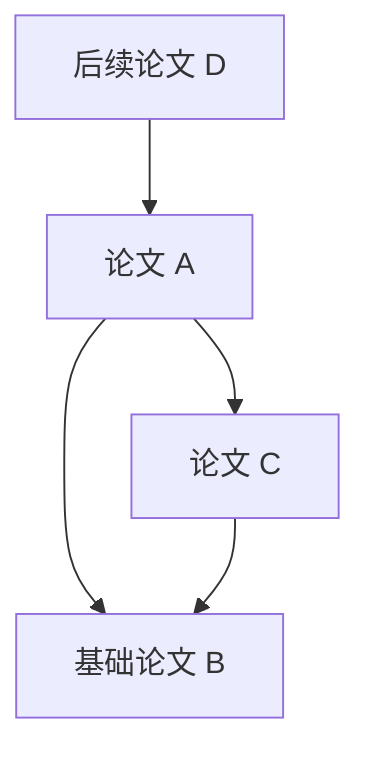

# Reference Topology

**从本地论文 PDF 出发，整理文献信息，建立可追溯的引用关系图。**

Reference Topology 计划使用 **Python + SQLite** 构建本地 Web 文献工作台。用户在浏览器中选择本机 PDF，由 Python 后端登记文件 URI，提取论文本身及参考文献的信息，识别文献之间的引用关系，并通过交互图和列表浏览、核对和打开已有 PDF。

> **当前状态：需求与设计阶段。** 本仓库目前仅包含项目说明和[实施计划](docs/PLAN.md)，尚未提供应用程序、数据库迁移、安装包或可运行的启动命令。下文的功能和使用流程均为拟实现目标。

## 一、项目动机

阅读一篇论文时，参考文献表通常只是正文末尾的一组文字。为了继续阅读相关研究，往往需要反复识别标题、查找已有文件、核对版本，并手动记忆论文之间的关系。论文积累后，仅凭文件夹和文件名很难回答以下问题：

- 这篇论文引用了哪些工作？哪些已经有本地 PDF？
- 我的文献集合中，哪些论文引用了这篇论文？
- 两篇论文共同引用了哪些基础工作？
- 同一文献是否被不同文件名或不同参考文献写法重复登记？
- 某条引用关系来自哪一份 PDF、哪一条参考文献，是否经过人工确认？

本项目希望把“阅读文件”“整理书目信息”和“追踪引用关系”连接起来。文献节点可以先只有元数据，之后再关联 PDF；文件移动时仍保留文献身份和引用证据。

## 二、与 Zotero 及两个插件的关系

本项目以以下开源项目为设计和实现研究基础：

| 项目 | 重点借鉴 | 本项目中的对应设计 |
| --- | --- | --- |
| [Zotero](https://github.com/zotero/zotero) | 文献与附件分离、托管文件和链接文件、文献识别流程 | 独立的文献、PDF 内容及文件位置模型；后续可选 Zotero 导入 |
| [Zotero Reference](https://github.com/MuiseDestiny/zotero-reference) | 参考文献区段解析、多个信息来源、缓存和人工编辑 | 保留原始参考条目，分离本地解析与可选联网补全 |
| [Zotero Reference Linker](https://github.com/ottersem/zotero-reference-linker) | 标识符优先、保守的书目匹配、已有 PDF 跳转 | DOI/arXiv 优先匹配，歧义进入复核，匹配后打开本地 PDF |

这些客户端和插件包含依赖 Zotero、浏览器阅读器及 JavaScript/TypeScript 运行环境的代码，不能作为 Python 库直接导入。项目将独立实现 Python 业务层；是否复用或移植具体源码，按[计划中的来源与许可证记录](docs/PLAN.md#二上游依据与复用边界)处理。

另有两项语义边界：

- Zotero Reference 的 Related Items 是双向关联，不能直接解释为双方互相引用。
- Reference Linker 主要解决参考文献与已有文献库的匹配，不等同于本项目所需的持久有向引用图。

上述判断的源码入口及固定提交见[实施计划](docs/PLAN.md#二上游依据与复用边界)。核心工作台拟独立运行，使用者无需先安装 Zotero 或两个插件。

## 三、拟提供的功能

| 功能 | 预期行为 |
| --- | --- |
| 选择本地 PDF | 从用户设置的允许目录中选择文件，登记真实 URI；另提供上传托管副本的兼容入口 |
| 打开 PDF | 点击文献或文件的“打开 PDF”，由本机后端通过 HTTP 提供文件，在浏览器查看 |
| 识别论文本身 | 提取标题、有序作者、年份、出版物、DOI/arXiv 等标识及可获取的摘要；允许人工纠正 |
| 解析参考文献 | 定位参考文献区段，保存原文、页位置及结构化字段；明确显示失败和待复核状态 |
| 匹配与去重 | 分别处理相同文件去重、文献身份匹配和人工文献合并；保留判断依据 |
| 引用拓扑 | 展示引用方向、已知被引用关系、局部邻居，以及无本地 PDF 的文献节点 |
| 人工复核 | 处理候选冲突，修正元数据和匹配结果，保护人工决定不被自动重解析覆盖 |
| 持久保存 | 使用本地 SQLite 保存元数据、文件位置、原始条目、解析历史及引用证据 |
| 导出与恢复 | 逐步提供书目和图数据导出，以及数据库、托管文件和解析证据的备份恢复 |

首期范围、后续扩展和逐项验收条件见[实施计划](docs/PLAN.md)。

## 四、如何使用（实现后的预期流程）

### 1. 启动本机工作台

在存放论文的电脑上启动 Python 服务，再用该电脑的浏览器打开工作台。拟默认使用 `http://127.0.0.1:8765`；端口可配置，正式安装与启动方式在应用实现后补充。

浏览器和后端默认运行于同一台电脑。远程服务器不能仅凭浏览器提交的文件名，读取用户电脑上的原文件。

### 2. 选择文件登记方式

**推荐：登记原位文件。** 设置允许访问的论文目录，例如 `D:\Papers` 或 `/home/user/Papers`，然后在工作台的目录浏览器中选择一个或多个 PDF。后端记录其真实 URI 和内容哈希，原文件保留在原位置。

**兼容：上传托管副本。** 使用浏览器文件选择框或拖放 PDF，将文件复制到本机工作台的数据目录。此模式记录托管副本的位置；如果不知道原文件的绝对路径，原始 URI 就保存为空，并在界面中标明。

普通网页文件选择框不会提供真实绝对路径，`C:\fakepath\...` 也不是真实路径，不能据此登记原文件 URI。参见 [MDN 文件选择说明](https://developer.mozilla.org/en-US/docs/Web/HTML/Reference/Elements/input/file)。

### 3. 提取并复核文献信息

工作台先读取 PDF 的元数据和文字，再识别论文本身及参考文献。界面显示解析进度、来源和异常；对标题缺失、多个候选、扫描件或无法定位参考文献区段的情况，提供人工处理入口。

默认采用本地处理。可选的本机 GROBID 引擎用于加强结构化解析；联网元数据补全独立启用。扫描件需要 OCR，本项目不会把“没有提取到文字”当作“没有参考文献”。解析器方案见[计划第五节](docs/PLAN.md#五解析匹配与人工复核)。

### 4. 浏览引用关系图

选择一篇论文，查看它的参考文献、已知施引文献和局部拓扑。点击节点查看元数据及附件；点击边查看原始参考条目、来源文件、解析版本和确认方式。

找不到本地 PDF 的参考文献仍可保留为文献节点。尚不能确定身份的条目显示为待确认占位对象，不计入已确认引用统计。之后导入更多 PDF 时，可以补全附件和已有匹配。

### 5. 再次打开、重解析和恢复文件位置

刷新页面或重启服务后，文献信息和链接继续从 SQLite 加载。原文件移动或被删除时，工作台提示位置失效；用户重新选择同一内容的文件后恢复关联，已有引用图和人工修正继续保留。

登记原位文件时，备份数据库不会自动备份原 PDF。托管副本、原始解析证据和数据库的备份范围将在备份界面分别列出。

## 五、怎样理解引用方向和“被引用”

统一约定：**`A → B` 表示 A 引用 B。**

在这个示例中，A 的参考文献包括 B、C；B 的已知施引文献包括 A、C；D 引用了 A。

“被引用”通过反向查询数据库中已确认的引用关系得到。**仅导入 A 的 PDF，通常只能获得 A 的参考文献，不能从 A 自身得知全球所有引用 A 的论文。** 界面将区分“本地已知被引用数”和后续可选外部数据源提供的统计，注明覆盖范围和获取时间。

这里的“拓扑”指有向关系网络，不要求图无环，也不等同于对论文执行拓扑排序。主题相近、共同作者、推荐关联或 Zotero Related Items 不自动成为引用边。

## 六、本地文件与数据库

文件的三个概念分别管理：

| 概念 | 用途 | 示例 |
| --- | --- | --- |
| 本地位置 URI | 后端定位原文件或托管副本 | `file:///D:/Papers/paper.pdf` |
| PDF 内容身份 | 用 SHA-256 识别相同字节，支持重复导入和位置重绑定 | `pdf_assets.id` 与内容哈希 |
| 浏览器打开链接 | 后端根据已登记文件 ID 提供 PDF | `/api/files/{file_id}/content` |

数据库保存文献信息、文件位置、解析结果和引用证据；PDF 字节保存在文件系统中。一个文献可以关联多个 PDF，一个 PDF 内容可以有多个保存位置。文件名、路径和标题都不直接充当文献主键。

点击 PDF 时使用本机 HTTP 链接，不依赖网页直接打开 `file://`，也不把浏览器临时 `blob:` URL 当成长期链接。后端只读取已经登记且处于允许目录内的文件。

SQLite 表、字段、约束、索引、事务及备份设计见[计划第六节](docs/PLAN.md#六sqlite3-数据库设计)。

## 七、技术方向与阶段

拟采用 Python、FastAPI、Python 标准库 `sqlite3`、本地 PDF 文字处理工具，以及用于交互图的 Cytoscape.js。浏览器展示使用少量 JavaScript，解析、匹配、持久化和图查询由 Python 后端负责。第三方前端资源随应用提供，以支持离线使用。

实施顺序拟为：

1. 数据模型、文件登记和浏览器 PDF 打开。
2. 论文本身与参考文献解析、来源保存和人工复核。
3. 文献匹配、引用图、反向引用查询和增量导入。
4. 中断恢复、备份、导出、跨平台使用说明与验收。
5. 按需增加 Zotero 只读导入、OCR、联网元数据补全和外部施引文献扩展。

首期不包含自动下载所有参考文献全文、云端协作或对 Zotero 数据库的直接写入。

## 八、文档导航与来源

- [docs/PLAN.md](docs/PLAN.md)：需求、技术边界、架构、数据库、接口、阶段安排及验收。
- [Zotero 源码](https://github.com/zotero/zotero)。
- [Zotero Reference 源码](https://github.com/MuiseDestiny/zotero-reference)。
- [Zotero Reference Linker 源码](https://github.com/ottersem/zotero-reference-linker)。

上游许可证分别为 AGPLv3、AGPLv3 和 MIT，固定版本和许可证文件链接见[实施计划](docs/PLAN.md#二上游依据与复用边界)。本轮只建立项目文档；后续引入源码时再据实际复用内容记录版权和许可要求，并确定本项目的许可证。
