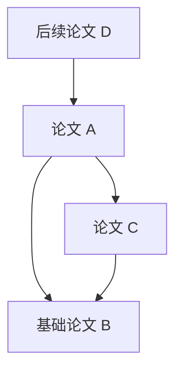

# Reference Topology

**从本地论文 PDF 出发，整理文献信息，建立可追溯的引用关系图。**

Reference Topology 是使用 **Python + SQLite** 实现的本地 Web 文献工作台。在浏览器中选择本机 PDF，后端记录文件 URI、解析论文与参考文献，保存原始证据，并以列表和有向图呈现引用关系。文件、文献身份和引用证据分别管理；移动 PDF 不需要重建整张图。

> **当前版本：0.1.0 开发版。** 已实现本地文件登记、解析、复核、引用图、导出和备份恢复。默认解析器面向带文字层的论文，结果需要核对。Linux 自动化测试已运行；Windows、浏览器完整交互、真实论文格式基准和真实 GROBID 服务仍待实机验收。详细状态见 [实施计划](docs/PLAN.md)。

## 一、为什么做这个项目

阅读一篇论文时，参考文献表通常只是正文末尾的一组文字。继续阅读相关研究需要识别标题、查找已有文件、核对版本，并记住它们之间的关系。文献积累后，仅靠文件夹和文件名很难回答：

- 这篇论文引用了哪些工作？哪些已经有本地 PDF？
- 我的文献集合中，哪些论文引用了这篇论文？
- 同一文献是否因为不同文件名或不同书目写法而重复登记？
- 某条引用来自哪份 PDF、哪条原文，是否经过人工确认？

本项目将“阅读文件”“整理书目”和“追踪引用”连接起来。文献可以先只有书目信息，之后再补上 PDF；自动结果与人工决定都保留来源。

## 二、当前功能

| 功能 | 0.1 开发版的行为 |
| --- | --- |
| 本地 PDF 选择 | 在允许目录内浏览、单选或多选；另支持上传托管副本 |
| URI 与再次打开 | 保存真实位置 URI、SHA-256 和稳定文件 ID；通过同源 HTTP 打开 PDF，支持 Range/HEAD |
| 论文与参考文献解析 | pypdf + pdfminer.six 本地规则；保存原文、可获取的页位置、解析器版本和运行快照 |
| 文献匹配 | DOI/arXiv 等明确证据优先；标题和书目相似度用于候选，歧义等待人工复核 |
| 人工复核 | 编辑文献、接受/拒绝/撤回匹配、创建无 PDF 的目标文献、修订完整参考条目列表 |
| 引用图 | Cytoscape.js 局部有向图、入边/出边筛选、待确认条目、边证据和本地已知施引文献 |
| 去重与合并 | 同字节 PDF 幂等导入；文献身份合并、别名查询及受版本保护的撤销 |
| 任务与恢复 | SQLite 持久队列、解析子进程、超时、取消、重试、租约及中断恢复 |
| 文件失联 | 明确报告缺失或内容变化；重新绑定相同内容的文件，保留文献与引用 |
| 导出与备份 | CSL-JSON、基础 BibTeX、有界图 JSON；数据库/托管 PDF/解析工件备份及 CLI 恢复 |

核心工作台不要求 Zotero、API key 或云服务。安装完成后，页面与图资源从本机提供，不依赖 CDN；可选 GROBID 只连接本机服务，并关闭外部元数据 consolidation。

## 三、安装与启动

需要 **Python 3.12 或更高版本**及现代桌面浏览器。当前测试环境使用 Python 3.12；首次安装依赖需要联网。浏览器与 Python 服务应运行在存放论文的同一台电脑。

先下载或克隆包含本实现的代码：

```bash
git clone https://github.com/ncut-d1z/reference-topology.git
cd reference-topology
```

首版实现尚在 PR 中时，先执行 `git switch feat/local-reference-workbench`；合并后可直接使用 `main`。

### Ubuntu / Linux

```bash
python3 -m venv .venv
.venv/bin/python -m pip install -e .
.venv/bin/python -m reference_topology
```

更推荐直接运行自适应启动脚本，无需指定 Python 小版本：

```bash
./run.sh
```

### Windows PowerShell

```powershell
py -3 -m venv .venv
.\.venv\Scripts\python.exe -m pip install -e .
.\.venv\Scripts\python.exe -m reference_topology
```

推荐直接使用 `run.ps1`。两个启动脚本均**不锁定 Python 小版本**，而是使用项目声明的最低版本 `>=3.12`：优先复用已有 `.venv` 和 `.venv-py*`；如果依赖未安装则先尝试修复该环境；仍不可用时枚举系统已安装的兼容 Python，在新的 `.venv` 或 `.venv-py<版本>` 中安装依赖。原有虚拟环境不会被删除或覆盖。Windows 通过 `PATH` 和 `py -0p` 搜索，Linux 通过 `PATH` 搜索。只有安装的解释器均不满足版本要求，或全部无法安装依赖时，才明确报错。上述显式命令不要求激活虚拟环境，执行前需确认 `python3` 或 `py -3` 指向的版本符合最低要求。

### pip 安装镜像

`run.ps1` 和 `run.sh` 的 **pip 默认源为清华 TUNA**：`https://pypi.tuna.tsinghua.edu.cn/simple`。仅影响脚本及其子进程，不会修改系统或用户级 pip 配置；Pip 的构建隔离过程也使用这一索引。若已经设置 `PIP_INDEX_URL`，启动脚本会尊重该显式值。例如临时切换为官方源：

Windows PowerShell：

```powershell
$env:PIP_INDEX_URL = 'https://pypi.org/simple'
.\run.ps1 --check
Remove-Item Env:PIP_INDEX_URL
```

Linux：

```bash
PIP_INDEX_URL=https://pypi.org/simple ./run.sh --check
```

清华镜像的[官方说明](https://mirrors.tuna.tsinghua.edu.cn/help/pypi/)提及对欧盟用户的访问限制。如果镜像返回地区性拒绝访问，使用上述一次性环境变量覆盖方式即可，无需删除虚拟环境。**镜像源和 Python 兼容性是不同问题。** 例如 Python 3.14 因缺少匹配的 `pydantic-core` wheel 而安装失败时，启动脚本会保留该环境，并在本机其他已安装的兼容解释器中尝试安装；若无可用替代则报错，不会强行安装 Python 3.12。

启动后打开 **<http://127.0.0.1:8765>**。停止服务使用终端的 `Ctrl+C`。默认仅监听本机回环地址，当前版本按单用户、单应用进程设计。

### 指定数据目录和论文目录

Linux 示例：

```bash
.venv/bin/python -m reference_topology \
  --data-dir "$HOME/.local/share/reference-topology" \
  --root "$HOME/Papers"
```

Windows 示例：

```powershell
.\.venv\Scripts\python.exe -m reference_topology --data-dir 'D:\ReferenceTopologyData' --root 'D:\Papers'
```

`--root` 必须指向已有绝对目录，可以重复指定。也可以先启动，再在工作台“设置”页填写目录。允许目录和解析器选择会持久保存。已保存的目录后来移走或磁盘暂时离线时，服务仍能启动，方便修改设置和重绑定文件。

完整配置示例见 [config.example.toml](config.example.toml)，通过 `--config /path/to/config.toml` 读取。优先级是命令行、TOML 中明确给出的值、已保存的设置、默认值；在 TOML 中保留 `allowed_roots = []` 会覆盖界面之前保存的目录。

检查配置与数据库、随后退出：

```bash
.venv/bin/python -m reference_topology --check
```

## 四、使用流程

### 1. 导入论文

在“设置”中添加论文目录，然后点击“导入论文”。有两种方式：

- **登记原位文件**：在工作台目录浏览器中选择 PDF。原文件留在原处，后端记录真实 URI 和内容哈希。
- **上传托管副本**：通过浏览器文件框或拖放上传 PDF，复制到本机工作台数据目录。只记录托管副本 URI，未知的原始 URI 保存为空。

普通网页文件选择框不会提供真实绝对路径，`C:\fakepath\...` 不能用于定位原文件；参见 [MDN 文件选择说明](https://developer.mozilla.org/en-US/docs/Web/HTML/Reference/Elements/input/file)。远程服务器也不能仅凭文件名读取用户电脑上的原文件。

默认单份 PDF 上限为 100 MiB、1,000 页，解析超时为 120 秒；上传请求还有合计大小限制，大批文件请分批导入。文件登记成功后创建解析任务，相同字节重复导入复用文件身份。

### 2. 查看解析结果

“解析任务”页显示排队、运行、完成、部分完成和失败等状态。点击文献查看标题、作者、年份、DOI、附件和解析记录；缺失或错误信息可以人工修改。

默认引擎 `python-rules` 不向外发送 PDF。它采用文字和布局规则处理常见编号式、作者年份式条目，不能保证任意出版格式的自动准确性。无文字层的扫描件会标记 `needs_ocr`；没有可靠参考区段会留下部分结果与提示，不会把失败当成成功的空参考表。

### 3. 核对参考文献

“参考文献复核”保留每条参考文献的原文、来源、候选和判断。可接受目标、拒绝候选、撤回已有决定，或为明确的参考文献创建暂时没有 PDF 的书目节点。

如果条目被错误拆分或合并，使用“修订条目列表”，选择具体来源快照，再编辑其完整条目列表；空行分隔条目。人工修订形成新的完整快照，原始证据继续保留。后续自动解析保护人工字段和人工列表；条目能明确对齐时继承人工决定，无法安全对齐时需要重新复核。

发现重复书目时，可在文献详情合并到已有文献。合并保留原始身份与证据；界面支持撤销本次合并。发生后续编辑或合并冲突时，系统会阻止直接撤销。

### 4. 浏览引用图、打开 PDF

在“引用图谱”选择中心文献、方向和深度。点击节点查看文献，点击边查看支撑该关系的参考条目。待确认项使用单独状态，确认统计只包含有效关系。

统一约定 **`A → B` 表示 A 引用 B**：



在这个示例中，A 的参考文献包括 B、C；B 的已知施引文献包括 A、C。**被引用关系只覆盖当前文献库已知的引用证据，不是全球引用次数。** 只导入 A 的 PDF，通常不能得知所有引用 A 的其他论文。图允许环，不要求拓扑排序或有向无环图。

点击“打开 PDF”后，浏览器访问 `/api/files/{file_id}/content`。后端校验登记位置和内容后提供 PDF，不依赖网页打开 `file://`，也不使用临时 `blob:` URL 作为长期地址。

### 5. 移动文件后恢复链接

PDF 移动、删除或被替换后，点击文件会得到明确错误。将新目录加入允许目录，再在文献附件上选择“重绑定”，指定同一内容的 PDF。SHA-256 必须一致；不同版本的 PDF 应作为新文件导入，不能冒充旧文件。数据库中的文献身份、人工修正和引用证据继续保留。

## 五、本地数据、备份与导出

默认数据目录：

- Windows：`%LOCALAPPDATA%\ReferenceTopology`
- Linux：`${XDG_DATA_HOME:-~/.local/share}/reference-topology`

其中 `reference_topology.sqlite3` 保存文献和引用；`managed/` 保存上传的 PDF；`artifacts/` 保存解析输出；`backups/` 保存备份 ZIP；`settings.json` 保存本机配置。原位登记的 PDF 继续留在用户原目录。

数据库使用 13 张表，将文献、元数据来源、作者/标识、PDF 内容、位置、附件关联、解析快照、原始参考条目、引用判断、合并历史、任务和迁移分开。每次连接启用外键，使用 WAL 和显式事务；解析结果与任务终态在同一个事务内发布。实际结构见 [001_initial.sql](src/reference_topology/migrations/001_initial.sql)，设计理由见 [PLAN 第六节](docs/PLAN.md#六sqlite3-数据库设计)。

### 创建备份

可以在“设置”页创建并下载备份，或从命令行运行：

```bash
.venv/bin/python -m reference_topology --backup
```

若使用自定义数据目录，备份时也传相同的 `--data-dir`。备份包含一致的 SQLite 快照、已登记托管 PDF、被快照引用的解析工件和带哈希的 manifest。

**原位 PDF 不包含在 ZIP 中，需自行备份原论文目录。** ZIP 会保留文件位置记录，因此可能包含本机路径；普通 CSL-JSON/BibTeX/图导出不包含这些路径。备份创建目前是同步操作，大型文献库可能需要等待。当前备份上限为展开总量 2 GiB、单文件 512 MiB、20,000 个文件。

### 恢复到新目录

先停止目标服务，再指定一个不存在或为空的目录：

```bash
.venv/bin/python -m reference_topology \
  --restore /path/to/backup.zip \
  --data-dir /path/to/restored-data

.venv/bin/python -m reference_topology --data-dir /path/to/restored-data
```

恢复会验证路径、大小、文件哈希、数据库结构与外键，不覆盖非空目录。托管 PDF 和解析工件重新定位到新目录；原位 PDF 保留历史 URI，需重新授权目录并重绑定。恢复后的未完成任务标记为中断，由用户重试。

### 导出

“设置”提供 CSL-JSON、基础 BibTeX 和图 JSON 导出。书目导出覆盖当前文献库，输出已有的标题、作者、年份等基础字段；当前采用文章类型模板，其他出版物类型需在导出后核对。图导出受节点/边上限约束，并携带截断说明；完整数据迁移应使用备份恢复。

## 六、实现边界与后续工作

- OCR、Zotero 导入、联网元数据补全、外部施引文献获取和 PDF.js 条目高亮尚未实现。
- 可选 `grobid-local` 适配器已有请求/响应和禁用外部补全的测试，真实 GROBID 服务仍待验收；默认安装不包含 GROBID。
- 默认规则解析器尚未经过大规模真实论文准确率评估。双栏、跨页等合成用例有测试，但不能据此承诺所有中文或复杂排版自动识别正确。
- 页面已接入实际 API 并通过 JavaScript 语法及 DOM 引用检查；完整浏览器交互验收仍待完成。
- 已提供 Linux 与 Windows 启动方式；当前自动化验证运行于 Linux/Python 3.12，Windows 行为尚未实机验证。
- 0.1 面向本机单用户使用；不提供多用户认证、云端同步、全文自动下载或任意远程文件访问。

## 七、开发与验证

```bash
.venv/bin/python -m pip install -e '.[test]'
.venv/bin/python -m pytest -q
```

Windows 使用 `.\.venv\Scripts\python.exe` 执行对应命令。测试使用临时目录和动态生成的合成 PDF，不修改私人文献。

已覆盖真实 PDF 子进程与后台队列、原位/托管导入、URI 持久化、Range、内容变更与重绑定、人工复核与重解析、引用方向、合并撤销、租约/取消竞态、备份下载与 CLI 恢复。测试集合见 [tests](tests)，实现阶段与剩余验收见 [docs/PLAN.md](docs/PLAN.md)。

主要入口：`app.py` 提供 HTTP 接口，`files.py` 管理文件，`parsing.py`/`matching.py` 处理解析和匹配，`storage.py` 管理 SQLite 与证据，`jobs.py`/`parse_worker.py` 处理任务，`maintenance.py` 负责备份恢复，`static/` 提供中文页面与本地图库。

## 八、与 Zotero 及两个插件的关系

本项目研究以下开源项目的职责划分和交互，再独立实现 Python 业务层：

| 项目 | 借鉴方向 |
| --- | --- |
| [Zotero](https://github.com/zotero/zotero) | 文献与附件分离、托管/原位文件、文献识别流程 |
| [Zotero Reference](https://github.com/MuiseDestiny/zotero-reference) | 参考区段、原文保存、多来源和人工编辑 |
| [Zotero Reference Linker](https://github.com/ottersem/zotero-reference-linker) | 标识符优先、保守书目匹配、已有 PDF 跳转 |

客户端和插件依赖 Zotero 及 JavaScript/TypeScript 阅读器环境，不能直接作为 Python 库导入。Related Items 的双向关联也不能直接解释为引用关系。固定提交、源码入口和许可证依据见 [PLAN 第二节](docs/PLAN.md#二上游依据与复用边界)。

当前实现未复制或翻译上述 AGPL 源码。随应用提供的 Cytoscape.js 使用 MIT 许可证，版本、来源与版权文件见 [THIRD_PARTY_NOTICES.md](THIRD_PARTY_NOTICES.md)。本项目自身的许可证尚未确定。
