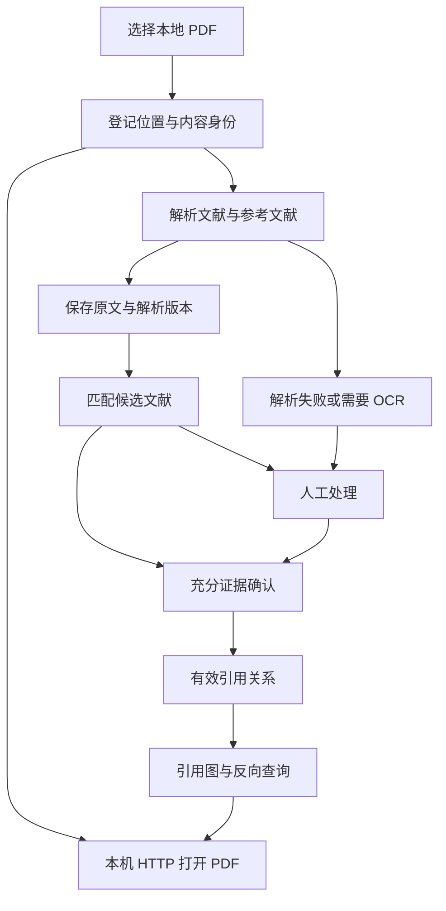
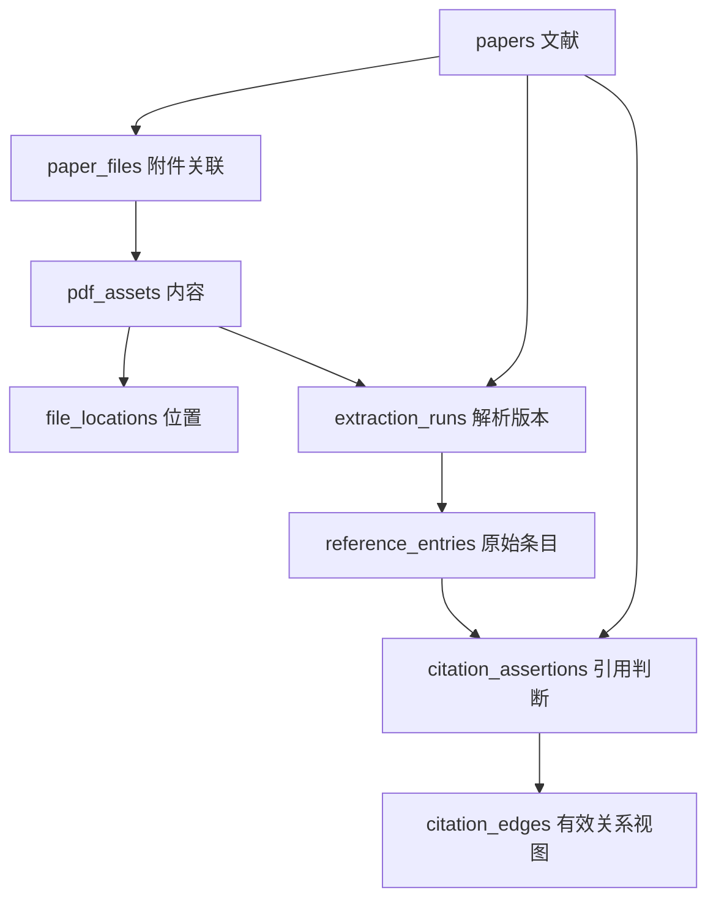

# Reference Topology 实施计划

**文档状态：0.1.0 开发版的实现基线与剩余验收计划。**

当前已实现本地 Python Web 工作台的核心闭环：允许目录内登记 PDF 或上传托管副本，保存内容身份与 URI，经同源 HTTP 打开 PDF，后台解析论文与参考文献，在 SQLite 保存原文和人工决定，建立可追溯的引用/被引用图，并提供重绑定、任务恢复、数据导出和完整备份恢复。核心模块、SQL 迁移、静态界面、CLI 与自动化测试均已进入源码。

当前开发环境中的自动化测试已覆盖合成 PDF、真实本地解析子进程、HTTP 接口、数据一致性与故障恢复。**这仍是开发版：Windows 实机、实际浏览器交互、真实论文格式质量基准、真实 GROBID 服务及规模性能尚未完成验收。** Zotero 只读导入、OCR、联网补全与外部施引扩展仍是后续目标。

本计划保留完整目标、上游依据和数据库设计。第三节列出实际模块，第八节描述当前 API 与配置，第九、十节将核心实现完成与尚未验收的内容分别列明。详细设计中的预留来源类型、字段或后续能力，不等于当前版本已有对应集成入口；测试结果也不等于所有论文格式或所有平台均已验证。

## 一、目标、范围与关键约定

### 1.1 项目目标

让用户在浏览器选择本地论文 PDF，后端保存可持续定位文件的 URI，解析论文本身及参考文献，保存到本地 SQLite，并建立能够说明来源的有向引用图。用户可在图中查看引用和已知被引用关系，随时打开已有 PDF，修正文献和匹配错误。

### 1.2 需求清单

| 编号 | 需求 | 完成标准 |
| --- | --- | --- |
| R01 | 在 Web 中选择本地 PDF | 支持允许目录内的单选、多选；记录真实位置并明确导入方式 |
| R02 | 保存 URI 并再次打开 | 服务重启后，通过稳定文件 ID 的 HTTP 地址打开正确 PDF |
| R03 | 识别论文自身 | 保存标题、作者顺序、年份、类型、出版物、标识符等；缺失值和冲突可复核 |
| R04 | 解析参考文献 | 保存每条原文、顺序、可获得的页位置、解析字段及解析器版本 |
| R05 | 匹配文献实体 | 采用强标识优先与保守候选匹配；区分文件去重与文献合并 |
| R06 | 展示引用/被引用 | `引用者 → 被引者`；反向查询与正向查询来自相同的有效关系集合 |
| R07 | SQLite 持久化 | 文件、文献、证据、解析版本和人工决定分离；具有约束、索引及迁移方案 |
| R08 | 人工核对与修正 | 可接受、拒绝或纠正候选；自动重解析不覆盖已有人工决定 |
| R09 | 增量导入与恢复 | 重复导入幂等；文件移动、任务中断和解析失败不破坏已有结果 |
| R10 | 本地独立运行 | Windows、Ubuntu 为首批验收平台；核心流程不要求 Zotero、云服务或 API key |
| R11 | 图的证据与范围 | 节点、边及统计注明来源；未确认项、外部统计与本地确认项有明确区别 |
| R12 | 可复现维护 | 能备份、恢复和导出；依赖与解析器版本可记录，原文件保持只读 |

### 1.3 首期范围

首期面向单用户、浏览器与后端同机、本地磁盘 SQLite 的工作方式。核心闭环为：选择文件、登记位置、提取与复核、匹配入库、查看图、打开 PDF、重启后继续使用。

第一版以带文字层的论文 PDF 为主要处理对象，优先英文及常见编号式、作者年份式书目。合成双栏、跨页及作者年份样本已有测试；真实中文、不同出版社和复杂排版仍须建立质量基准。扫描件识别为 `needs_ocr` 后仍可打开 PDF、编辑书目信息；当前完整参考条目修订依赖有效基础快照，尚未把无活动快照时直接起稿参考列表作为已完成能力。

后续扩展包括 Zotero 只读导入、OCR、联网元数据补全、外部施引文献获取及 PDF.js 条目高亮。首期不实现自动下载参考文献全文、云端多人协作、移动端后端、任意远程原文件访问或直接修改 `zotero.sqlite`。

### 1.4 关系语义

- 文献主键是应用生成的稳定 ID，不是 DOI、标题或文件路径。
- PDF 内容身份、文件位置、书目身份独立；相同 SHA-256 只说明文件字节相同。
- `A → B` 只表示 A 引用 B。入边表示当前数据范围内已知的施引文献。
- 引用图允许环；“拓扑结构图”不要求有向无环图，也不代表执行拓扑排序。
- 推荐相似、共同作者、Zotero Related Items、预印本与正式版之间的版本关系，都不能直接成为引用边。
- 文献是否有本地 PDF、元数据是否确认、引用是否确认是三个独立状态。

## 二、上游依据与复用边界

以下为建立项目设计基线时实际阅读的固定提交。引用固定提交用于说明设计依据，不表示要求永远使用这一版本；接入具体上游功能时仍需核实发行版和接口。

| 上游 | 检视分支与提交 | 可借鉴内容 | 许可证文件 |
| --- | --- | --- | --- |
| Zotero | `main` / `212a7d6a585d1209bc4e698a904490205f139500` | 文献/附件分离、原位文件与托管文件、识别流程 | [COPYING：AGPLv3](https://github.com/zotero/zotero/blob/212a7d6a585d1209bc4e698a904490205f139500/COPYING) |
| Zotero Reference | `bootstrap` / `4a64b65a3ad18e2d98dc2aaad93dffa8f03fde27` | 参考文献区段与跨行解析、多来源、缓存、人工编辑 | [LICENSE：AGPLv3](https://github.com/MuiseDestiny/zotero-reference/blob/4a64b65a3ad18e2d98dc2aaad93dffa8f03fde27/LICENSE) |
| Zotero Reference Linker | `main` / `9423c0bae60c933337983fed8d874ff54343cac6` | DOI/arXiv、书目指纹、标题匹配及歧义处理 | [LICENSE：MIT](https://github.com/ottersem/zotero-reference-linker/blob/9423c0bae60c933337983fed8d874ff54343cac6/LICENSE) |

### 2.1 Zotero

[attachments.js](https://github.com/zotero/zotero/blob/212a7d6a585d1209bc4e698a904490205f139500/chrome/content/zotero/xpcom/attachments.js) 区分导入附件和链接附件，可借鉴其“书目对象不等于文件”的建模方式。

[recognizeDocument.js](https://github.com/zotero/zotero/blob/212a7d6a585d1209bc4e698a904490205f139500/chrome/content/zotero/xpcom/recognizeDocument.js) 先通过 PDFWorker 获取识别数据，随后请求识别服务，再按 DOI、arXiv、ISBN 等取得元数据；无有效文字存在 `noOCR` 路径。该流程包含联网步骤，不能称为可直接移植的纯离线 Python 识别器。

后续 Zotero 适配器优先研究[本地 API](https://github.com/zotero/zotero/blob/212a7d6a585d1209bc4e698a904490205f139500/chrome/content/zotero/xpcom/server/server_localAPI.js) 或导出文件。运行时探测实际客户端版本、可用路由和权限；不把上游 `main` 的能力当成用户某一发行版的保证，也不设计对 Zotero 数据库的直接写入。0.1 开发版尚未提供 Zotero 导入适配器。

### 2.2 Zotero Reference

重点入口为 [pdf.ts](https://github.com/MuiseDestiny/zotero-reference/blob/4a64b65a3ad18e2d98dc2aaad93dffa8f03fde27/src/modules/pdf.ts)、[utils.ts](https://github.com/MuiseDestiny/zotero-reference/blob/4a64b65a3ad18e2d98dc2aaad93dffa8f03fde27/src/modules/utils.ts)、[views.ts](https://github.com/MuiseDestiny/zotero-reference/blob/4a64b65a3ad18e2d98dc2aaad93dffa8f03fde27/src/modules/views.ts) 和 [api.ts](https://github.com/MuiseDestiny/zotero-reference/blob/4a64b65a3ad18e2d98dc2aaad93dffa8f03fde27/src/modules/api.ts)。

可借鉴页面文字与坐标合并、参考区段解析、原文编辑和多来源处理。其阅读器对象及 Zotero 条目 API 需要由 Python 文件解析和数据库接口替代。

`views.ts` 中对两条文献分别调用 `addRelatedItem`，建立的是双向关联。`GraphData.ts` 使用 [ConnectedPapersClient 远程图接口](https://github.com/MuiseDestiny/zotero-reference/blob/4a64b65a3ad18e2d98dc2aaad93dffa8f03fde27/src/modules/GraphData.ts)。这些结果均不能无区别地导入为“从 PDF 原文确认的有向引用”。

### 2.3 Zotero Reference Linker

重点入口为 [PdfSectionExtractor.ts](https://github.com/ottersem/zotero-reference-linker/blob/9423c0bae60c933337983fed8d874ff54343cac6/src/core/PdfSectionExtractor.ts)、[CitationParser.ts](https://github.com/ottersem/zotero-reference-linker/blob/9423c0bae60c933337983fed8d874ff54343cac6/src/core/CitationParser.ts)、[normalize.ts](https://github.com/ottersem/zotero-reference-linker/blob/9423c0bae60c933337983fed8d874ff54343cac6/src/core/normalize.ts)、[LibraryMatcher.ts](https://github.com/ottersem/zotero-reference-linker/blob/9423c0bae60c933337983fed8d874ff54343cac6/src/core/LibraryMatcher.ts)。

其[README](https://github.com/ottersem/zotero-reference-linker/blob/9423c0bae60c933337983fed8d874ff54343cac6/README.md) 和匹配源码采用 DOI、arXiv、无标题条目的书目指纹、规范化标题及保守模糊匹配，并对歧义保持不链接。新项目参考这一职责划分；具体阈值必须用本项目样本验证，不能直接把匹配分数宣称为概率。

[ReaderIntegration.ts](https://github.com/ottersem/zotero-reference-linker/blob/9423c0bae60c933337983fed8d874ff54343cac6/src/reader/ReaderIntegration.ts) 依赖 Zotero Reader 和 PDF.js 内部对象，不能在 Python 中直接导入。该固定版本的 Related Items 集成仍为 TODO，不能据此假设已有可复用的引用数据库。

### 2.4 复用方式

当前 Python 实现采用研究职责划分与交互后独立编写的路线。若后续复制、翻译或改编具体上游代码，必须记录上游提交、文件、修改、版权和许可证，并在明确整体许可后纳入发布。不能因为改写成 Python 就假设原许可不再适用。已随应用分发的 Cytoscape.js 与其许可证保存在 `static/vendor/`；项目许可选择与未来具体上游源码改编分别处理。

## 三、整体架构与技术选择

### 3.1 技术基线

| 层 | 当前采用方案 | 选择理由与边界 |
| --- | --- | --- |
| 运行环境 | Python 3.12 及以上的受支持版本 | 首批验证 Windows、Ubuntu；实施时锁定依赖与兼容范围，不在计划中虚构已验证版本组合 |
| HTTP 与页面 | FastAPI、Uvicorn，静态 HTML/CSS/JavaScript | Python 管理业务与文件；当前不需要独立前端服务或前端构建进程 |
| 数据库 | Python 标准库 `sqlite3`，显式 SQL 迁移 | 单机存储、明确约束与事务；不引入外部数据库服务 |
| PDF 预检和元数据 | pypdf | 读取文件结构、自带元数据；不能仅凭 PDF 的 Title 字段确认书目身份 |
| 页面文字与布局 | pdfminer.six | 获取字符、行和文本块位置，为区段与跨行重建提供依据 |
| 结构化解析 | `python-rules` 基线；可选 `grobid-local` | 前者为 Python 规则与人工复核闭环；后者通过 HTTP 连接本机独立服务 |
| 图展示 | Cytoscape.js | 浏览器布局、方向、缩放、筛选和节点交互；图事实由后端生成 |
| 长任务 | SQLite 持久队列、单个调度线程、可终止解析子进程 | 解析不占用请求线程；lease、取消、失败和重试状态持久保存 |
| PDF 查看 | 同源 HTTP + 浏览器内置查看器 | 后续增加本地 PDF.js 以稳定支持定位和高亮 |

相关官方依据：[FastAPI](https://fastapi.tiangolo.com/)、[Python sqlite3](https://docs.python.org/3/library/sqlite3.html)、[pypdf](https://pypdf.readthedocs.io/en/stable/user/extract-text.html)、[pdfminer.six](https://pdfminersix.readthedocs.io/en/latest/topic/converting_pdf_to_text.html)、[Cytoscape.js](https://js.cytoscape.org/)。具体库的选用属于本项目设计决定，性能和准确率需要后续验收。

应用安装完成后，核心静态资源从本机提供，不在运行时依赖 CDN。首次安装的依赖及可选模型下载，与处理用户 PDF 时的联网行为分别说明。

### 3.2 业务流程



文件登记、文字提取、论文识别、条目解析、实体匹配、引用确认分别报告结果。登记成功并不意味着解析成功；提取到文字也不意味着已经确认全部参考文献。

### 3.3 当前模块与职责

以下路径相对于项目根目录，均对应当前源码。为了使第一版可直接运行，业务模块采用 `.py` 文件；以后有明确拆分需要时再重构为子包。

| 实际路径 | 职责 |
| --- | --- |
| `src/reference_topology/app.py` | FastAPI 路由、请求字段校验、文件/文献/复核/任务/图接口及导出入口 |
| `src/reference_topology/files.py` | 允许目录、URI、内容哈希、只读快照、托管文件、重绑定和 PDF 响应输入 |
| `src/reference_topology/parsing.py` | PDF 预检、文字/布局、区段与条目解析，以及可选本机 GROBID 适配 |
| `src/reference_topology/matching.py` | DOI/arXiv/标题规范化、候选匹配、冲突说明和保守自动接受判定 |
| `src/reference_topology/storage.py` | sqlite3 事务、元数据与证据、人工修订、canonical 合并/撤销、引用视图、图查询与任务租约 |
| `src/reference_topology/migrations/001_initial.sql` | 13 张表、约束、索引、引用视图及不可变证据触发器 |
| `src/reference_topology/jobs.py`、`parse_worker.py` | 持久任务调度、解析子进程、heartbeat、超时/取消及结果发布 |
| `src/reference_topology/security.py` | 本机会话、Host/Origin/CSRF 校验、请求大小限制与响应安全头 |
| `src/reference_topology/config.py`、`__main__.py` | TOML/CLI/本机设置、服务启动、检查、备份及恢复命令 |
| `src/reference_topology/maintenance.py` | 数据库和引用文件的一致 ZIP 备份、安全校验、重定位及原子恢复 |
| `src/reference_topology/static/` | 文献库、引用图、复核、任务与设置的静态界面；`vendor/` 提供本机 Cytoscape.js |
| `tests/test_app.py`、`tests/test_parsing.py`、`tests/test_storage.py`、`tests/test_maintenance.py` | 动态生成合成 PDF、HTTP/子进程集成、数据一致性、匹配与备份恢复测试 |

数据目录与源码目录分开；用户 PDF、SQLite、日志、凭据和生成的验证工件不进入 Git。Zotero、OCR 和外部 provider 暂无对应运行模块。

## 四、本地 PDF 的选择、URI 与浏览器访问

### 4.1 两种明确的登记方式

| 模式 | 文件选择 | 后端存储 | URI 语义 |
| --- | --- | --- | --- |
| `linked`，默认 | 工作台枚举已配置允许目录，用户选择；HTTP 传入 `root_id` 与目录内相对路径列表 | 原文件只读，保存哈希和位置 | 保存原始 URI 与解析后的规范位置 URI |
| `managed`，兼容 | 浏览器文件选择框或拖放后上传至本机 | 使用内部文件 ID 保存托管副本，禁止按不可信原文件名拼路径 | 托管副本具有真实 URI；不知道原位置时 `original_uri=NULL` |

[HTML 文件选择框](https://developer.mozilla.org/en-US/docs/Web/HTML/Reference/Elements/input/file) 不提供真实绝对路径，`C:\fakepath\...`、客户端提交的文件名或 `webkitRelativePath` 不能冒充真实本机绝对 URI。File System Access API 也不作为跨浏览器 MVP 的前提。

默认允许目录由本机配置指定，工作台只显示已授权根目录。后续可加原生系统选择器，但它是本机辅助程序，不作为普通网页天然具有的能力。

### 4.2 URI 与身份处理

1. 后端使用当前平台的路径规则解析用户选择，检查真实路径、符号链接、可读性和 PDF 类型，再用标准 URI 转换记录位置。参见 [pathlib](https://docs.python.org/3/library/pathlib.html#pathlib.Path.as_uri)。
2. 记录 `host_id`、原始 URI、规范 URI、文件大小、修改时间、最后检查时间；中文、空格、`#`、盘符和大小写按平台与 URI 规则处理，不能把整个路径一律转小写。
3. 流式计算 SHA-256；对哈希计算和解析期间文件变化进行前后检查，必要时使用同一打开句柄或临时快照，避免解析内容与记录哈希不一致。
4. 相同哈希复用 `pdf_assets`；位置不同则增加 `file_locations`。同名、同路径但哈希不同，创建新的内容记录并将旧位置映射标为失效，不能覆盖旧解析证据。
5. 文件移动后保留旧位置记录，验证新位置的哈希后重绑定；若内容不同，则提示新版本/新文件，不假装是原文件恢复。
6. 未识别论文也可以登记 PDF；已有元数据但没有 PDF 的文献也可以成为节点。

### 4.3 PDF 打开协议

已实现 `GET /api/files/{file_id}/content` 和 `HEAD /api/files/{file_id}/content`，其中 `file_id` 指 `pdf_assets.id`。后端选择本机可访问的位置，再次检查目录边界与内容哈希，创建只读临时快照并返回文件；响应结束后清理快照，避免在旧文件 ID 下发送被替换的内容。

成功响应使用 `Content-Type: application/pdf`、`Content-Disposition: inline`，基于 [Starlette FileResponse](https://starlette.dev/responses/) 提供 Range、`206`、`416` 与 HEAD；ETag 使用内容 hash。`Last-Modified` 是响应快照的时间，不承诺代表原位文件修改时间。HTTP 行为已有自动化覆盖，浏览器内置查看器的实际交互仍待验收；浏览器若禁用了 PDF 查看，会受其设置影响。PDF.js 统一阅读界面属于后续扩展。

不提供任意 `?path=` 文件下载接口。缺失、越界、文件内容已更换分别返回明确错误；不能在旧文件 ID 下悄悄提供另一篇论文。网页保留稳定应用 URL，SQLite 保留文件位置；不持久化临时 `blob:` 地址。[浏览器对 file 来源的处理](https://developer.mozilla.org/en-US/docs/Web/Security/Defenses/Same-origin_policy) 存在限制，因此 `file://` 只作为文件定位数据。

### 4.4 本机边界

默认仅绑定 `127.0.0.1`；校验 Host、同源请求和本机会话，对修改操作校验 CSRF token，拒绝跨站调用本地文件接口。路径允许范围在登记、目录浏览、重绑定和实际读取时均检查，不只在第一次登记时检查。PDF 解析使用资源限额和可终止工作进程。

归档文献、移除数据库关联与删除磁盘文件是不同动作。首期不删除用户原位 PDF；托管副本清理必须先确认没有有效引用并提供明确操作。远程部署另行设计，不能沿用“后端所在文件系统就是用户文件系统”的前提。

## 五、解析、匹配与人工复核

### 5.1 统一解析输出

每次解析产生不可变快照，至少包含输入文件哈希、文献 ID、引擎名称/版本、配置指纹、开始/结束时间、状态、警告、原始输出及其哈希。

论文自身输出候选标题、有序作者、日期/年份、文献类型、出版物、卷期页码/文章号、DOI/arXiv 等标识、语言和可提取的摘要。PDF 内置元数据、首页、正文及外部数据分别标明来源；不要把 REFERENCES 中他人的 DOI 误认为本论文 DOI。

参考条目输出顺序号、原编号、原文、结构化字段、页码和可用的位置片段。跨页条目使用位置列表；不存在的页码/坐标保存为 `NULL`，不能编造。文中引用位置与文末书目条目是不同对象，正文上下文识别作为后续增强。

### 5.2 默认 Python 本地解析

`python-rules` 分阶段实施：PDF/XMP 元数据读取 → 页面文字和布局 → 参考文献区段定位 → 条目分割 → 字段提取。

区段定位先利用可用结构信息，再识别 References、Bibliography、参考文献等标题及编号/作者年份模式。考虑双栏阅读顺序、跨行、跨页、页眉页脚、附录和无标题书目；不能只搜索 DOI 或只扫描最后一页。

字段提取保留原文，同时生成规范化副本。标题规范化包括空白、大小写、断行连字符及标点处理，但不能丢失用于人工核对的原始文本。优先在已确定的区段内识别标识符；作者、年份、卷页与标题可部分缺失。

这个引擎是有明确支持范围的基线。识别不可靠时返回候选或 `needs_review`，允许用户指定参考区段、粘贴原文或人工拆分/合并条目；不能把空结果统一当成“本论文无参考文献”。PDF 文字恢复本身存在布局困难，文本库也不是 OCR 引擎，见 [pdfminer.six 的布局说明](https://pdfminersix.readthedocs.io/en/latest/topic/converting_pdf_to_text.html) 与 [pypdf 的提取边界](https://pypdf.readthedocs.io/en/stable/user/extract-text.html)。

### 5.3 可选本机 GROBID

`grobid-local` 通过 Python HTTP 客户端调用本机独立 GROBID 服务。它可提供论文头部、参考文献和全文 TEI 结构，见 [GROBID 功能](https://grobid.readthedocs.io/en/latest/Introduction/) 与 [REST API](https://grobid.readthedocs.io/en/latest/Grobid-service/)。GROBID 不是 Python 包；其运行资源和安装方式另行说明，不作为基础文件管理功能的前置条件。

0.1 已实现适配器，并用模拟 HTTP/TEI 响应验证本机地址约束、参数和归一化路径；尚未以真实 GROBID 安装完成联调，不能据此宣称其解析质量或具体服务版本兼容性已经验收。

适配器根据固定版本和实际端点传入支持的参数。默认离线模式显式设置 `consolidateHeader=0`、`consolidateCitations=0`、`consolidateFunders=0`；支持时设置 `includeRawCitations=1`。这些参数和服务版本写入运行记录。

原因是官方 API 中部分头部补全默认启用，会请求 Crossref 或 biblio-glutton；“服务位于 localhost”并不等于“不访问网络”。保存原始 TEI 与归一化结果；服务不可达、超时、无内容和部分解析分别显示，不自动改用远程公共解析服务。

### 5.4 文献匹配与去重

| 顺序 | 依据 | 接受条件 |
| --- | --- | --- |
| 1 | 规范化 DOI、arXiv 等强标识 | 唯一候选、标识合法，且无明显标题/类型冲突 |
| 2 | 缺少标题时的书目指纹 | 作者、年份、出版物、卷号与首页/文章号形成足够的共同证据 |
| 3 | 规范化标题 + 作者/年份 | 结合字段一致性；标题一致也不能无条件合并 |
| 4 | 保守模糊匹配 | 返回候选、分数、采用字段与冲突原因；首期默认人工决定 |
| 5 | 无可靠候选 | 保留未解决条目；信息足够时可创建无 PDF 的书目节点，否则保留条目占位 |

标识符提取须处理 DOI URL 前缀和参考条目末尾标点，保留原值；arXiv 基础 ID 与版本信息分开，不把预印本与正式出版物仅凭近似标题自动合并。DOI 的候选冲突先进入复核，不能为了满足唯一索引覆盖已有身份。

“条目已经被引用”与“条目对应哪个既有文献”分开判断。缺少本地 PDF 不阻止建立书目节点；但未确认条目边界或实体身份时，不能生成看似已确认的引用事实。新导入文献只增量重新匹配有关的未解决条目，不反复覆盖已确认结果。

### 5.5 人工修正与重解析

- 原文、原始解析输出保持不可变。人工编辑生成修订/候选值及其来源，不直接抹掉旧结果。
- 人工选中的字段优先于之后的自动候选；重新解析发现冲突时展示差异。
- 接受、拒绝和撤回匹配都保留记录。主动拒绝的匹配不能在下一次运行中无提示恢复。
- 新旧条目只能在同一输入内容、原文指纹及位置等证据明确时对齐；不能仅凭 `[12]` 这样的编号继承人工决定。
- 新运行完成并验证后，在短事务中切换当前采用快照。存在人工修订的条目快照时，自动结果保存为非活动版本；当前没有直接激活任意历史/候选 run 的 API，不能把这个保护规则说成已完成自动差异合并界面。失败、取消、部分异常不得清空上一完整结果。
- 原有人工确认保留记录和来源版本；选用新快照后，相关判断若存在冲突或仍无法确定条目对应，则标记待复核，排除默认已确认统计，不丢失历史、不强行迁移。
- 文献合并采用保留原始 ID 的别名映射及事件记录。撤销存在后续冲突时先列出差异，不能静默覆盖后来编辑。

### 5.6 联网扩展与 Zotero 适配

后续可选 provider 分别承担元数据补全和施引文献扩展。仅补全标题/DOI 的响应不能自动当作引用证据；外部提供明确引用关系时，记录提供者、记录 ID、查询范围、获取时间和原始响应。接入时核实官方接口、凭据、限流和允许用途，不照搬插件历史端点。

默认关闭外部请求，不自动上传 PDF 全文。用户启用某个补全 provider 时说明发送哪些标识或元数据；失败时保留本地结果。Zotero 适配器作为可选只读导入，记录来源实例、library ID、item key 和版本，禁止把普通 Related Items 自动转换成有向引用。

## 六、SQLite3 数据库设计

### 6.1 存储位置与通用约定

当前数据库位于 `<data_dir>/reference_topology.sqlite3`，托管 PDF 位于 `<data_dir>/managed/`，包含原始 TEI/页面文字的解析 JSON 工件位于 `<data_dir>/artifacts/`。数据库保存所属对象及 URI，备份清单对归档文件记录大小和内容 hash。托管目录是应用内部允许范围，无需另列入外部论文目录。

`data_dir` 默认使用本机用户数据目录，允许指定其他本地磁盘位置。活动数据库不放在网络共享盘或同步中的远程目录；原位 PDF 则仍在用户选择的位置。备份时区分数据库、托管文件、解析证据与外部原位文件。

结构约定：实体 ID 为 `TEXT` UUID；时间为 UTC ISO 8601 `TEXT`；大小、序号和布尔量为 `INTEGER`，布尔量约束为 0/1；分数为可空 `REAL`。未知年份、标识、坐标和路径用 `NULL`，不填虚构值。结构化候选及原始响应可使用 UTF-8 JSON `TEXT`，但文件、文献和关系主外键不藏在 JSON 中。

每个连接启用外键并校验设置生效。默认软归档文献、保留来源历史；外键采用明确的 `RESTRICT`/受控删除策略，避免一次删除级联抹掉引用证据。凡涉及多个对象的一致性变化均由服务层短事务完成。

### 6.2 核心实体关系



该图省略作者、元数据候选、任务和合并历史。首期采用以下 **13 张实体/管理表**，加可重建的关系视图；不把一整张引用网络作为单个 JSON 字段存入论文记录。

### 6.3 文献与元数据

| 表 | 主要字段及类型 | 约束与用途 |
| --- | --- | --- |
| `papers` | `id TEXT PK`；`title, title_normalized, publication_type, venue, volume, issue, pages, article_number, date_text, abstract, language TEXT`；`year INTEGER`；`record_status TEXT`；`canonical_paper_id TEXT FK papers`；`row_version INTEGER`；`created_at, updated_at, archived_at TEXT` | `record_status` 为 `stub/identified/reviewed`；标题不唯一；根记录的 `canonical_paper_id=NULL`；是否有可读 PDF 由关联查询计算 |
| `paper_identifiers` | `id TEXT PK`；`paper_id TEXT FK papers`；`scheme, value_raw, value_normalized TEXT`；`metadata_claim_id TEXT FK metadata_claims` | 只保存已接受标识；`UNIQUE(scheme, value_normalized)`；候选与冲突标识留在 claims，不抢占唯一身份 |
| `paper_authors` | `paper_id TEXT FK papers`；`position INTEGER`；`display_name, given_name, family_name, orcid TEXT` | `PRIMARY KEY(paper_id, position)`；`position>=1`；保留署名顺序；不按同名作者建立全局身份合并 |
| `metadata_claims` | `id TEXT PK`；`paper_id TEXT FK papers`；`field_name, value_json, source_kind TEXT`；`run_id TEXT FK extraction_runs` 可空；`reference_entry_id TEXT FK reference_entries` 可空；`source_key, source_url, observed_at TEXT`；`score REAL` 可空；`is_selected, is_manual INTEGER`；`supersedes_id TEXT FK metadata_claims`；`created_at TEXT` | 保存字段候选及来源，人工值不被自动覆盖；同一 paper/field 同时最多一个选中值；整组作者和标识集合分别作为有序/结构化字段快照 |

`papers`、`paper_authors` 和 `paper_identifiers` 是以原始 paper ID 为单位的当前选中元数据投影，与 claim 选择在同一事务更新。canonical 展示优先使用根记录的选中字段；根未选择的缺失字段可从别名补充，并以 `metadata_sources` 标明来源，根明确选择的空值也受到保护。已确认标识聚合根及其别名；合并不通过搬移 identifier 所有权实现。新导入 PDF 的 claims 保留在其原始 paper 上，使身份合并撤销后仍能恢复正确来源。标识集合的 claim 指明来源；多个 DOI 候选冲突时不静默扩大已确认集合。文件名只可作为临时显示标签，不当作已确认标题。

首期不做作者身份消歧，也不因作者同名共享一个全局作者记录。预印本、会议版、期刊扩展版默认保留独立书目身份；后续版本关系与 citation 分开建模。

### 6.4 PDF 内容、位置及文献附件

| 表 | 主要字段及类型 | 约束与用途 |
| --- | --- | --- |
| `pdf_assets` | `id TEXT PK`；`sha256 TEXT NOT NULL`；`byte_size INTEGER NOT NULL`；`page_count INTEGER` 可空；`mime_type TEXT`；`derived_from_asset_id TEXT FK pdf_assets` 可空；`created_at TEXT` | `sha256` 唯一；大小非负；内容身份不可修改；OCR/清洗产物另建 asset 并记录父来源；不存 PDF BLOB |
| `file_locations` | `id TEXT PK`；`asset_id TEXT FK pdf_assets`；`host_id, canonical_uri, original_uri, display_name, root_key TEXT`；`location_kind, status TEXT`；`is_current INTEGER`；`observed_size, observed_mtime_ns INTEGER`；`created_at, last_checked_at TEXT` | `location_kind=linked/managed`；`status=available/missing/inaccessible/changed`；上传原路径未知则 `original_uri=NULL`；当前 `(host_id, canonical_uri)` 唯一，历史映射可保留 |
| `paper_files` | `paper_id TEXT FK papers`；`asset_id TEXT FK pdf_assets`；`role TEXT`；`is_preferred INTEGER`；`created_at TEXT` | `PRIMARY KEY(paper_id, asset_id)`；`role=primary/alternate/supplement`；同一文献最多一个首选 PDF；多对多关联不自动推断合订本各文章边界 |

路径恢复时新增/更新位置历史，不删除论文。相同 URI 被新内容占用时，先将旧映射 `is_current=0`，再记录新 asset 的映射；旧解析仍指向旧 hash。相同字节在多个路径可共享 asset；同一论文不同字节的 PDF 是否归于一个 paper，仍由书目识别决定。

`host_id` 表示拥有这些路径的本机环境。把数据库恢复到另一台电脑后，需要重新验证或重绑定位置，不假定旧绝对路径仍然有效。原位文件失联不撤回已经保存的引用证据。

canonical 文献聚合根及别名的附件。当前优先检查根记录附件，再检查别名附件，各组内首选附件优先，并按登记顺序返回首个可读文件。用户仍可明确选择某个附件，不能因各原始记录各有首选就把多个文件都宣称为 canonical 唯一首选。

### 6.5 解析版本与原始参考条目

| 表 | 主要字段及类型 | 约束与用途 |
| --- | --- | --- |
| `extraction_runs` | `id TEXT PK`；`asset_id TEXT FK pdf_assets`；`source_paper_id TEXT FK papers`；`parser_name, parser_version, config_json, config_hash, input_sha256, cache_key TEXT`；`status TEXT`；`is_active INTEGER`；`base_run_id TEXT FK extraction_runs` 可空；`output_uri, output_sha256, warning_json, error_code TEXT`；`started_at, finished_at TEXT` | 输入/输出快照不可变；状态和活动指针按生命周期更新；同一 source/asset 同时最多一个当前采用的完整条目快照；失败运行不替换有效版本 |
| `reference_entries` | `id TEXT PK`；`run_id TEXT FK extraction_runs`；`source_paper_id TEXT FK papers`；`ordinal INTEGER`；`label, raw_text, parsed_json, locations_json, text_fingerprint TEXT`；`aligned_from_entry_id TEXT FK reference_entries` 可空；`created_at TEXT` | `UNIQUE(run_id, ordinal)`；序号从 1 开始；原文不可空；位置可以是跨页片段数组；原文保持不可变 |

运行开始前可为导入论文建立 `stub` 身份，之后选择元数据；因此 `source_paper_id` 不必空缺。`reference_entries` 的 source 必须与其 run 的 source 一致，使用复合外键或等价数据库约束落实，不能只依赖前端传参。

`cache_key` 记录 `input_sha256 + parser_name + parser_version + config_hash` 的组合，用于追溯和后续原始输出缓存；不对全部运行强制唯一，以允许显式重解析和不同 attempt。当前调度器按文件/配置的工作键复用既有任务，尚未实现独立的跨 run 原始工件缓存。同一 asset 关联不同 source 时，各自建立 run 和条目归属，不能直接复用另一论文的 run ID。

人工修改参考区段、拆分或合并条目时，建立 `manual-revision` 完整条目快照，并用 `base_run_id` 指向被修订版本；不能用一个不完整条目片段覆盖完整旧结果。`is_active` 同时适用于自动解析与人工修订，两者共用同一活动快照约束；活动人工修订不能被自动重解析静默替换。

`aligned_from_entry_id` 只记录同一输入内容下明确的一对一条目对应，并保存对齐依据；拆分、合并和含糊对应不自动继承人工决定。继承接受/拒绝时创建可追溯的新判断，保留旧判断及 supersedes 关系，防止被拒绝候选在重解析后复活。

大体积输出先写入临时文件，完成后原子移入 artifacts，再在事务中登记 URI/hash 和解析条目；失败时旧版本保持可见，孤立临时文件可回收。第一次只能得到部分结果时明确标记 `partial`；已有完整结果时，不自动用部分结果替换它。

### 6.6 引用判断与有效关系

`citation_assertions` 保存证据和判断，不对 `(citing_paper_id, cited_paper_id)` 设唯一，因为同一引用可以有多个独立来源。

| 字段 | 类型/约束 | 含义 |
| --- | --- | --- |
| `id` | `TEXT PK` | 一条引用判断的稳定 ID |
| `citing_paper_id` | `TEXT NOT NULL FK papers` | 引用者 |
| `cited_paper_id` | `TEXT FK papers`，可空 | 候选或已确认被引者；`accepted` 时必须存在 |
| `reference_entry_id` | `TEXT FK reference_entries`，可空 | PDF 原始条目证据；`source_kind=pdf` 时必填 |
| `source_kind` | `TEXT CHECK(pdf/manual/external)` | 证据类型；人工确认 PDF 匹配仍是 pdf 来源 |
| `provider, provider_record_id, source_url, observed_at` | 可空 `TEXT` | 外部来源身份和获取时间；external 时必须具备可追溯来源 |
| `status` | `TEXT CHECK(candidate/accepted/rejected/retracted)` | 当前版本的判断；未解决项留在原始条目，不必虚构被引目标 |
| `review_state` | `TEXT CHECK(current/needs_review)` | 默认 current；需要重新核对的判断保留历史，但不进入默认已确认图 |
| `is_current, is_pinned` | `INTEGER CHECK(0/1)` | 是否当前判断；人工固定决定可以独立于自动快照保留 |
| `method, matcher_version, evidence_json` | `TEXT` | 匹配规则、候选比较、冲突和人工理由 |
| `score` | 可空 `REAL` | 明确量纲的匹配分数，不宣称为校准概率 |
| `actor` | `TEXT CHECK(system/user)` | 判断由规则还是用户作出 |
| `supersedes_id` | 可空 `TEXT FK citation_assertions` | 被本次判断取代的历史版本 |
| `created_at` | `TEXT NOT NULL` | 判断时间 |

约束：accepted 必须有被引者；PDF 来源必须有条目且条目的 source 与 citing 一致；手工无条目关系必须有说明；同一参考条目最多一个当前 accepted 目标。拒绝与撤回通过新增判断、切换 `is_current` 保留历史，不删除原证据。

首期 `citation_edges` 是有效关系视图/查询，步骤为：

1. 选取 `accepted AND is_current=1 AND review_state='current'`，并验证证据满足以下活动策略。
2. 自动 PDF 判断只来自当前有效解析快照；人工固定判断保留优先级，但也必须通过 review_state 筛选。外部关系按提供者及稳定关系记录身份选取当前 assertion，不能因一次不完整分页响应缺少某边就撤回它；完整批次快照语义留给后续 provider 适配器定义。旧证据可以在历史视图查看。
3. 将原始文献 ID 映射到当前 canonical ID；合并映射保持直接指向根记录。
4. 对 canonical `(citing, cited)` 去重，一对文献只输出一条图边，同时保留证据 ID 列表和来源统计。
5. 合并导致的 canonical 自环进入复核，不计入正常图统计，也不删除原始 assertion。

图边是可重建的投影，不维护第二份无来源的事实表。以后性能需要时可以物化缓存，但更新必须可从 assertions 与活动版本完整重建。`citation_edges` 至少输出 `citing_paper_id, cited_paper_id, evidence_count, has_local_evidence, has_external_evidence`。

人工决定跨重解析的活动策略要与第五节一致：同一文件的明确条目对应关系允许继承；选用新快照后仍存在冲突或不明确对应时，相关旧人工证据设为 `needs_review`，保留展示但不计入已确认统计。`is_pinned` 不绕过这一规则。更换内容 hash 不自动迁移决定；查看当前版本与历史版本必须可区分。

### 6.7 合并历史、任务和迁移

| 表 | 主要字段及类型 | 约束与用途 |
| --- | --- | --- |
| `paper_merge_events` | `id TEXT PK`；`from_paper_id, to_paper_id TEXT FK papers`；`reason, actor, before_json, after_json, touched_versions_json TEXT`；`created_at, reverted_at TEXT` | 保存本次修改的别名映射、字段选择和对象版本；原始 paper、assertion 和来源 ID 不销毁；撤销只回退该事件可安全恢复的变化 |
| `jobs` | `id TEXT PK`；`kind TEXT`；`asset_id TEXT FK pdf_assets`、`paper_id TEXT FK papers` 可空；`request_key, work_key, request_aliases_json, input_json, result_json, attempt_history_json, status TEXT`；`progress_current, progress_total, attempt INTEGER`；`lease_token, lease_until, heartbeat_at, error_code, error_message, created_at, updated_at TEXT` | `request_key` 唯一，合并到同一活动工作时保留请求别名；同一 `work_key` 只能有一个 queued/running；lease token 与 attempt 历史防止过期 worker 发布 |
| `schema_migrations` | `version INTEGER PK`；`name, checksum, applied_at TEXT` | 有序 SQL 迁移和校验；迁移前备份，失败回滚；运行时拒绝不支持的更高 schema |

当前合并更新 canonical 映射、对象版本和事件记录，显示元数据通过根/别名投影获得，不销毁或搬移原始 claims、identifier、附件及引用证据。映射禁止成环，不能形成未解析长链：将 B 合并入 C 时，把原来指向 B 的别名在同一事务改指 C，并记录全部受影响对象。撤销遇到后续编辑或再次合并时返回冲突；自动 PDF 身份合并也有立即撤销的回归测试。

元数据修改的历史保存在 claims，引用判断历史保存在 assertions，合并历史单列；首期不再额外引入通用事件总线或复杂知识图谱模型。

### 6.8 关键约束与索引草案

以下 SQL 摘录表达关键约束与索引的设计意图。当前可执行定义在 [`001_initial.sql`](../src/reference_topology/migrations/001_initial.sql)，部分唯一性由建表内联约束提供，不应把本节摘录再次当成迁移执行。外部来源相关字段属于预留能力，不表示已经接入外部 provider。

参与业务唯一性与关系约束的关键字段必须 `NOT NULL`，包括所有实体主键、必需外键、`scheme/value_normalized`、`paper_id/field_name`、`host_id/canonical_uri`、`run_id/ordinal`、`jobs.request_key/work_key`。只有本节明确允许缺省的字段才可为空，避免 NULL 绕过预期唯一约束。

```sql
CREATE UNIQUE INDEX uq_pdf_content ON pdf_assets(sha256);
CREATE UNIQUE INDEX uq_paper_identifier
  ON paper_identifiers(scheme, value_normalized);
CREATE UNIQUE INDEX uq_current_file_location
  ON file_locations(host_id, canonical_uri) WHERE is_current = 1;
CREATE UNIQUE INDEX uq_preferred_pdf
  ON paper_files(paper_id) WHERE is_preferred = 1;
CREATE UNIQUE INDEX uq_selected_claim
  ON metadata_claims(paper_id, field_name) WHERE is_selected = 1;
CREATE UNIQUE INDEX uq_reference_ordinal
  ON reference_entries(run_id, ordinal);
CREATE UNIQUE INDEX uq_active_extraction
  ON extraction_runs(source_paper_id, asset_id) WHERE is_active = 1;
CREATE UNIQUE INDEX uq_accepted_reference_target
  ON citation_assertions(reference_entry_id)
  WHERE status = 'accepted' AND is_current = 1
        AND reference_entry_id IS NOT NULL;
CREATE UNIQUE INDEX uq_job_request ON jobs(request_key);
CREATE UNIQUE INDEX uq_active_work
  ON jobs(work_key) WHERE status IN ('queued', 'running');

CREATE INDEX idx_citation_out
  ON citation_assertions(citing_paper_id, status, is_current);
CREATE INDEX idx_citation_in
  ON citation_assertions(cited_paper_id, status, is_current);
CREATE INDEX idx_reference_source ON reference_entries(source_paper_id);
CREATE INDEX idx_reference_fingerprint
  ON reference_entries(text_fingerprint);
CREATE INDEX idx_run_cache ON extraction_runs(cache_key, status);
CREATE INDEX idx_location_asset ON file_locations(asset_id, status);
CREATE INDEX idx_paper_file_asset ON paper_files(asset_id);
CREATE INDEX idx_paper_title_year ON papers(title_normalized, year);
CREATE INDEX idx_paper_canonical ON papers(canonical_paper_id);
CREATE INDEX idx_job_recovery ON jobs(status, lease_until);
```

约束支持见 [SQLite 部分索引](https://www.sqlite.org/partialindex.html)。需要给其他高频外键查询补索引时，以实际查询计划为依据；不为每个字段无差别创建索引。书目检索初期用明确字段查询，FTS5 作为后续能力检测后启用的扩展。

正向/反向查询使用同一有效视图，例如以下绑定参数查询：

```sql
-- 这篇论文引用谁
SELECT cited_paper_id, evidence_count
FROM citation_edges
WHERE citing_paper_id = :paper_id AND has_local_evidence = 1;

-- 当前本地证据中，谁引用这篇论文
SELECT citing_paper_id, evidence_count
FROM citation_edges
WHERE cited_paper_id = :paper_id AND has_local_evidence = 1;
```

`:paper_id` 在查询前解析为 canonical ID。本地入度计算不同引用者数量，不按原始条目数、重复来源数或 PDF 副本数累加。外部 provider 的 `cited_by_count` 是带时间和来源的元数据统计，不能替代图中的真实入边。

### 6.9 并发、事务、恢复和备份

每个连接启用 `PRAGMA foreign_keys=ON`，设置有限 `busy_timeout`，在本地磁盘启用 WAL，并检查返回模式。WAL 可以改善读写并行，但同一时刻仍只有一个写入者；使用短事务和受控写入队列，解析、文件哈希和网络请求均在事务外进行。官方依据：[外键](https://www.sqlite.org/foreignkeys.html)、[WAL](https://www.sqlite.org/wal.html)、[busy_timeout](https://www.sqlite.org/pragma.html#pragma_busy_timeout)。

任务领取、lease 更新、结果发布采用明确事务；每个工作进程/线程使用自己的连接。长任务完成时再次检查 lease 和输入版本，防止过期 worker 覆盖新结果。请求重复、进程崩溃、重试和用户取消均应幂等。不能只使用进程内 `BackgroundTasks` 就声称支持重启恢复。

使用参数绑定与明确的 UPDATE/UPSERT，避免 `INSERT OR REPLACE` 删除后插入的语义破坏已有外键和来源，见 [SQLite 冲突处理](https://www.sqlite.org/lang_conflict.html)。发布新快照时，旧活动标记、新活动标记、确认结果和状态必须在同一事务切换。

运行中的数据库用 SQLite [backup API](https://www.sqlite.org/backup.html) 创建一致快照，不只复制主文件而忽略 WAL。备份清单记录 schema、托管文件及解析工件 hash；恢复后验证完整性及文件可达性。外部原位 PDF 不默认复制进备份，界面必须说明其恢复依赖。归档与清理分开，清理不得删除仍被来源记录引用的工件。

## 七、Web 工作台与图交互

### 7.1 页面职责

| 工作区 | 当前操作与边界 |
| --- | --- |
| 文献库 | 搜索标题/作者/年份/标识；选择 PDF；查看附件可用性、解析状态和任务进度 |
| 文献详情 | 展示采用的元数据与来源；打开首选 PDF；查看参考文献、已知施引文献、历史解析与人工修正 |
| 引用图 | 以选中文献为中心展开入边/出边；缩放、拖动、筛选、点击节点和边查看证据 |
| 待复核 | 对照原始条目和候选，接受/拒绝匹配、创建书目节点、纠正字段、修订条目边界 |
| 任务与维护 | 查看失败原因、重试/取消、重绑定文件、同步创建并下载备份、数据导出；恢复通过 CLI 进行 |
| 设置 | 配置允许目录及默认解析器，查看限制；其他限额从 TOML 读取，Zotero 与联网 provider 暂无启用入口 |

不把解析器内部日志作为普通用户的主要页面；错误信息给出可以采取的动作，同时保留诊断详情。原始参考文本按文本渲染，避免把 PDF 内容或 provider 返回值当作 HTML 执行。

### 7.2 图的展示规则

| 对象 | 显示与统计规则 |
| --- | --- |
| 已识别文献且有 PDF | 普通文献节点，显示可打开附件标记 |
| 已识别文献但无 PDF | 普通文献节点，显示“无本地 PDF”；可保留 DOI 等外部链接 |
| 不完整或歧义参考条目 | 使用 `reference:{entry_id}` 类型的待确认对象，虚线关系；与 `paper:{id}` 明确分开 |
| 已确认引用 | 实线箭头，支持查看一条或多条来源；箭头始终指向被引文献 |
| 外部 provider 关系（后续） | 数据模型预留来源标识；provider 接入、来源切换和多来源集成验收属于 M5 |

默认只统计有效的文献引用边。用户显示待确认项时，虚线不得计入“已确认被引用数”；颜色之外还使用线型、图标或文字，以便区分状态。

默认展示一跳邻居，可逐步扩展。初始建议上限为深度 3、节点 300、边 1,000，服务端强制上限，允许在后续性能验证后调整；响应包含 `truncated`、省略数量和继续展开入口。循环遍历维护 visited 集，不能因图有环无限展开，也不能因年份排序失败删掉真实边。

图布局在浏览器完成，邻居、证据和计数在后端计算。本地入度、当前显示子图入度、外部平台总被引数分别命名，不能混用。多份 PDF 或重复书目条目支持同一引用时，边只计一次。

### 7.3 最小交互闭环

验收演示至少包括 A 引用 B、C，C 引用 B 的小型集合：导入 A 后能看到参考候选；确认 B、C 身份后可显示出边；再导入 C 的 PDF 并确认其参考文献后，B 的本地施引列表包含 A、C。B 没有 PDF 时仍存在于图中；之后导入 B 的 PDF，只新增附件和相应新证据，不复制 B 节点。

## 八、当前 API、任务与配置

### 8.1 0.1 API 契约

以下以 [`app.py`](../src/reference_topology/app.py) 的实际路由和请求模型为准。除健康检查和会话引导外，API 需要本机会话 cookie；修改请求还需要 `X-CSRF-Token`，并通过 Host/Origin 校验。普通错误返回 `{"error":{"code":"...","message":"..."}}`；批量登记/上传返回 `items` 和 `errors`，调用方必须检查每项结果，不能只根据 HTTP 202 判断所有文件成功。

| 方法与路径 | 当前支持的输入、返回与边界 |
| --- | --- |
| `GET /api/session` | 设置 `rt_session` cookie，返回 `csrf_token` 与版本；服务重启后重新建立会话 |
| `GET /api/health` | 返回 `status/version/schema_version/local_parser/network_enabled`；是服务声明，不代替真实 GROBID 连通性或解析质量检查 |
| `GET /api/settings` | 返回允许目录、当前解析器、限额与数据目录 |
| `PUT /api/settings` | JSON 可含 `allowed_roots: string[]`、`engine`；当前只修改这两项并持久保存 |
| `GET /api/roots` | 返回 `items`，每项有已配置目录的 `id/name/path` |
| `GET /api/files/browse` | 查询参数 `root_id`、`path=""`、`offset=0`；`path` 是根内相对目录，返回目录/PDF 列表、总数及截断信息，单页最多 500 项 |
| `POST /api/files/register` | JSON：`root_id`、`paths: string[]`（1–100 项），可选 `request_key`；去重后逐项登记并入队，202 返回 `items[{file_id,paper_id,job_id,...}]` 与 `errors` |
| `POST /api/files/upload` | multipart 字段名为 `files`，最多 20 个 PDF；创建本机托管副本并入队，202 返回 `items/errors`；没有 `request_key` 字段，也不接受客户端绝对路径 |
| `GET/HEAD /api/files/{file_id}/content` | 返回核验后的 PDF 快照；支持 inline、Range、206/416、内容 hash ETag；缺失、越界、内容变化有明确错误 |
| `POST /api/files/{file_id}/rebind` | JSON：`root_id`、`path`；核验新位置的 hash 后增加位置映射 |
| `POST /api/files/{file_id}/parse` | JSON：可选 `engine`、`force`（默认 `true`）；202 返回任务与 `job_id`；无任意配置或 `request_key` 请求字段 |
| `GET /api/jobs`、`GET /api/jobs/{job_id}` | 列表返回最近任务，详情含状态、进度、attempt、错误及结果；界面轮询 |
| `POST /api/jobs/{job_id}/cancel` | 取消尚未提交完成结果的任务；已结束任务返回既有终态，不撤销已发布结果 |
| `POST /api/jobs/{job_id}/retry` | 对 failed/partial/interrupted/cancelled 任务显式重试，保留请求身份及 attempt 历史；202 返回任务 |
| `GET /api/papers` | 查询参数 `q`、`limit`（1–1,000，默认 100）、`offset`；返回 `items/total/limit/offset` |
| `GET /api/papers/{paper_id}` | 返回 canonical 详情、作者/标识、附件、claims、解析版本与关系计数；保留请求 ID 和别名信息 |
| `PATCH /api/papers/{paper_id}` | JSON：`fields`、可选 `expected_version`；提供版本时检查 `row_version`，保存人工候选并重匹配待解决条目；字段名不是 `expected_row_version` |
| `GET /api/papers/{paper_id}/references` | 返回 `items`，包含原文、parsed、位置、候选/决定、来源版本及待复核状态 |
| `GET /api/papers/{paper_id}/citations` | 返回本地已知施引 `items` 和 `scope="local-known"`；当前不接受外部来源范围或分页参数 |
| `POST /api/references/{entry_id}/decisions` | JSON：`action=accept/reject/retract`，可选 `target_paper_id`、`metadata`、`expected_assertion_id`、`reason`；接受时需指定目标或提供用于创建书目身份的元数据 |
| `POST /api/papers/{paper_id}/reference-revisions` | JSON：`base_run_id` 与完整 `references` 列表；缺少 `parsed` 时用本地单条解析补齐；检查活动基础快照后发布人工版本 |
| `POST /api/paper-merges` | JSON：`from_paper_id`、`to_paper_id`、可选 `reason`；创建保留原始身份的合并事件；当前 HTTP 请求没有 `expected_versions` 字段 |
| `POST /api/paper-merges/{merge_id}/revert` | 撤销可安全恢复的合并；存在后续编辑/合并时返回 revision conflict，不静默覆盖 |
| `GET /api/graph` | 查询参数 `center`、`direction=both/in/out`、`depth`（默认 1）、`limit`（默认 300）、`include_pending`（默认 false）；返回 nodes/edges、覆盖范围和截断信息；当前无 `source_scope` 或 `max_edges` 请求参数 |
| `GET /api/graph/edges` | 查询参数 `source`、`target`；返回该有效边的原始条目、解析版本及决定证据 |
| `GET /api/exports/{format}` | `format=csl-json/bibtex/graph-json`；返回下载。当前没有文献 ID 列表、中心或来源筛选等导出范围参数 |
| `POST /api/backups` | **同步创建** SQLite、托管 PDF 和解析工件的一致 ZIP，200 返回清单及 `download_url`；当前不是后台任务，不返回 `job_id` |
| `GET /api/backups/{backup_id}/download` | 下载本机已创建的备份 ZIP |

`request_key` 目前只在批量原位登记模型中公开，并为各项解析任务派生请求键；数据库的内容去重和持久队列去重与此分别工作。它不是所有 HTTP 修改接口通用的幂等协议。上传既受每个 PDF 的 `max_pdf_size_mb` 限制，也受整次请求约 `max_pdf_size_mb + 1 MiB` 的上限约束；多文件大批量需分批发送。

当前 CSL-JSON/BibTeX 导出包含全部未归档 canonical 文献的基础书目信息，分别使用 `article-journal`/`@article` 的简化类型映射；不能视为完整文献类型的无损交换。Graph JSON 导出采用全局有界子图并保留截断信息，不等于导出全部数据库边或当前浏览器所选子图。三类数据导出不包含绝对文件路径；完整备份为恢复保留 URI 与目录来源。

备份恢复目前使用 CLI `reference-topology --restore BACKUP.zip --data-dir NEW_DIRECTORY`，没有在线恢复 API。恢复只接受空目录或新目录，使用新 host ID、重定位托管文件和解析工件，原位 PDF 需重新授权目录并重绑定。当前也没有归档/删除文献或磁盘清理 API；相关状态字段仍是后续接口设计的基础。

### 8.2 当前任务生命周期

`jobs.status` 为 `queued/running/succeeded/partial/failed/cancelled/interrupted`。`needs_review` 是文献或条目的业务状态，不让等待人工确认的任务长期占据 running。

当前采用单个调度线程从 SQLite 领取任务，为每次 attempt 生成 lease token，定期 heartbeat，并把 PDF 解析放入可终止子进程。启动和调度期间将 lease 过期的 running 标记为 interrupted；目前由用户显式重试，没有自动重试次数配置。重试前检查已有结果和工作键，重复文件、任务与关系不重复创建。

发布解析快照时，在同一数据库事务内核验 lease、切换活动结果并写入任务结果/终态；取消与发布竞争时只能有一个事务先完成。取消后或 lease 过期的 worker 无法发布，已经完成的任务也不会被之后的取消请求改成 cancelled。此行为有专门回归测试。

正常解析 `succeeded` 对应任务 succeeded；部分解析和 `needs_ocr` 对应带明确解析结果的 partial 任务。解析异常/超时进入 failed，取消为 cancelled，服务停止或 lease 过期为 interrupted。失败任务可能没有新建的 extraction run：最后完整活动快照仍保持可查，错误与 attempt 历史保存在 jobs。任务处理结束并不表示全部元数据和引用都已人工确认。

### 8.3 当前配置 schema

以下与根目录 [`config.example.toml`](../config.example.toml) 的实际字段一致：

```toml
[server]
host = "127.0.0.1"
port = 8765

[storage]
data_dir = ""  # 空值使用平台用户数据目录，不写到仓库

[files]
allowed_roots = []  # 例如 ["/home/user/Papers"] 或 ['D:\Papers']
max_pdf_size_mb = 100
max_pdf_pages = 1000

[parser]
engine = "python-rules"  # python-rules | grobid-local
timeout_seconds = 120

[parser.grobid]
base_url = "http://127.0.0.1:8070"
# 当前适配器强制关闭所有 consolidation，不向外部服务补全元数据。

[graph]
maximum_depth = 3
maximum_nodes = 300
maximum_edges = 1000
```

通过 `--config` 读取 TOML；`--data-dir`、`--root`、`--host`、`--port` 可覆盖相应启动参数。未指定数据目录时，Windows 使用本机用户应用数据目录，其他系统使用 XDG 用户数据目录或其默认路径。本机 `settings.json` 保存 `host_id`、允许目录、默认解析器与 GROBID 地址；会话和 CSRF token 仅在服务进程中生成，不写入该文件。

当前不支持早期草案中的 `default_mode`、`workers`、`network.enabled/providers`、`graph.default_depth` 或可配置 consolidation 字段。原位登记和上传由不同入口明确选择；默认图深度来自 API；调度器当前为单 worker。没有已实现的联网 provider；GROBID 只接受 loopback 地址并在请求中强制关闭三类 consolidation，尚无远程服务或 API key 配置入口。

图限额可以调小；存储层仍保留深度 3、节点 300、边 1,000 的硬上限，调大 TOML 不代表已经放开这些限制。文件大小、页数、超时和图上限是边界参数，不是吞吐或质量承诺。解析配置指纹和引擎版本进入 extraction run，具体任务参数保存在 jobs 输入；影响解析结果的配置变更必须改变指纹。

## 九、实施阶段与交付物

| 阶段 | 依赖 | 0.1 实现状态 | 仍须完成的验收或目标 |
| --- | --- | --- | --- |
| M0 文档基线 | 无 | **完成**：项目动机、上游依据、13 表模型与范围已建立，并同步当前接口 | 随实际发布继续维护；设计条目不能替代实现证据 |
| M1 本地文件与持久化 | M0 | **核心完成**：两种登记、URI/hash、数据库迁移、重绑定、PDF HTTP、会话和路径边界已有实现与自动化覆盖 | Windows 实机、实际浏览器 PDF 查看、不同平台路径/权限组合仍需验收 |
| M2 解析与证据 | M1 | **核心完成**：本地规则解析、运行证据、持久队列、人工快照保护；GROBID 适配器及模拟契约测试已有 | 真实出版社/中文格式质量基准、真实 GROBID 联调、无活动快照时的人工参考列表起稿入口待补 |
| M3 匹配与引用图 | M2 | **核心完成**：强标识、保守候选、无 PDF 节点、确认/拒绝、合并/撤销、有效边与正反向图；后导入 PDF 补全既有节点已测 | 实际浏览器的选择/复核/图交互验收，以及独立真实样本上的错误率评估 |
| M4 可用性与恢复 | M3 | **核心完成**：失联/重绑定、任务取消与重试、完整 ZIP 备份/离线恢复、基础导出、依赖与启动入口；wheel 构建及解包启动检查已通过 | Windows/Ubuntu 实机一致性、真实崩溃和断网演练、异机恢复、导出类型完整性与规模性能仍待验收/增强 |
| M5 可选扩展 | M4 | **未实施**：Zotero 只读导入、OCR、联网补全、外部施引获取、PDF.js 高亮、高级搜索 | 各扩展独立接入、明确数据发送范围并建立验收；继续保持核心本地闭环 |

M1–M4 的“核心完成”表示纵向源码与指定自动化验证已经具备，不表示整个阶段的跨平台、真实数据和交互验收已经完成。发布说明需同时写出实现范围、验证环境和残余缺口，不用阶段名称掩盖尚未验证的能力。

后续优先补充真实数据基准、跨平台与浏览器验收，再扩展 M5。模糊匹配仍默认人工决定；基础导出不批量下载第三方 PDF；完整备份只复制本机托管 PDF 和已引用的解析工件，原位 PDF 由用户另行备份。

## 十、验收方案

本节区分已经执行的自动化验证与仍需完成的验收。当前开发环境中的测试套件已通过，覆盖解析/匹配、SQLite、文件/HTTP 边界、真实解析子进程及备份恢复；集成测试仍随功能补充，因此本文不固定易过时的测试总数。使用 `python -m pytest -q` 执行完整套件，以相应提交上的实际输出为准。

此外已成功构建 wheel，并从解包后的包目录运行 `--check`，核对 SQL 迁移、静态页面、Cytoscape.js 及其版权文件随包提供。这是当前环境的打包与启动验证，不替代 Windows 安装或实际浏览器验收。

合成 PDF 是测试时动态生成的材料，能验证已知结构和故障路径，**不能替代真实期刊/会议论文集的质量评估，也不能替代 Windows 和实际浏览器操作**。真实样本验收应记录来源、许可、文件 hash、人工标注、解析器版本、配置和操作环境。

| 当前测试文件 | 已有自动化证据 | 不能据此宣称的结果 |
| --- | --- | --- |
| `tests/test_parsing.py` | 本文/参考文献 DOI 分离、合成双栏/跨页/作者年份样本、无标题参考区段、扫描型输入、解析 worker、保守匹配、模拟 GROBID 参数/TEI | 任意出版社格式、真实中文准确率、真实 GROBID 版本质量和全部损坏/加密 PDF 组合 |
| `tests/test_storage.py` | 13 表与迁移、文件身份、重启、引用证据去重/反查、后导入 PDF、人工覆盖保护、完整快照、事务回滚、合并/撤销、循环图、任务租约与发布竞争 | 大规模性能、真实操作系统崩溃后的全部恢复路径、浏览器可用性 |
| `tests/test_app.py` | 本机 HTTP、中文/空格/`#` 文件名、Range/HEAD、路径边界、会话/CSRF、上传、真实本地解析与复核/图闭环、配置持久化及相关集成路径 | 浏览器图布局、焦点/键盘操作、浏览器内置 PDF 设置和 Windows 实机体验 |
| `tests/test_maintenance.py` | 一致备份、托管/工件重定位、新 host 恢复、原位文件待重绑定、ZIP 路径/重复成员/符号链接/哈希/schema/限额校验 | 不同真实机器之间的全部路径迁移、海量备份性能与灾难恢复演练 |

### 10.1 功能与异常验收

| 编号 | 场景 | 验收目标 | 当前证据与剩余验收 |
| --- | --- | --- | --- |
| A01 | Windows/Ubuntu 目录，含中文、空格和 `#` | URI 正确，重启后打开相同内容 | 当前环境 HTTP/重启测试通过；Windows 实机与平台路径组合待验 |
| A02 | 上传时只有文件名 | 托管 URI 真实，原始 URI 为空 | HTTP 上传自动化通过；实际浏览器选择/拖放交互待验 |
| A03 | 重复登记、相同内容位于两个目录 | 一个 asset、多位置，不重复 paper/边 | 数据层与 HTTP 重复导入测试通过 |
| A04 | 同一位置被其他 PDF 覆盖 | 旧 file_id 不发送新内容，旧证据保留 | 数据层内容/位置分离与 HTTP 内容变化测试通过 |
| A05 | 移动、丢失、权限变化及恢复 | 关系保留，相同 hash 可重绑定 | 移动/失联/重绑定自动化通过；权限与平台组合待补 |
| A06 | 越界、符号链接、跨站请求 | 路径边界及本机会话有效 | 路径、Host、Origin、session、CSRF 已测；Windows 特定权限行为待验 |
| A07 | GET、HEAD、Range、非法范围 | 正确内容、inline、206/416及浏览器查看 | HTTP 自动化通过；真实浏览器内置查看器尚待验收 |
| A08 | 本文 DOI 与参考文献 DOI 同时存在 | 不把参考文献 DOI 认作本文 DOI | 合成单页/多页材料与真实解析路径已测 |
| A09 | 多种排版、作者年份、中文、无 DOI | 原文可追溯，超出支持范围进入复核 | 英文合成双栏/跨页/作者年份等已有覆盖；真实中文与出版社基准待建 |
| A10 | 扫描、加密、损坏、空区段 | 明确 needs_ocr/失败/复核，不谎报完整零结果 | 扫描型/损坏/空区段已有自动化；加密及复杂损坏组合待扩充 |
| A11 | 同名、近似标题、预印本/正式版 | 不无条件合并，解释冲突 | 标识冲突和保守标题匹配已有测试；真实版本身份样本待验 |
| A12 | A→B、A→C、C→B与引用环 | 方向、反查及计数一致，遍历有界 | 数据层/HTTP方向反查及循环图已测；完整浏览器演示待验 |
| A13 | 多个条目/来源支持同一引用 | 一条边、多份证据，入度不重复 | 本地重复证据测试通过；外部多来源集成留待 M5 |
| A14 | 待确认条目、无 PDF 文献、外部关系 | 状态区分，待确认不计入确认入度 | 本地占位/无 PDF 节点与计数已测；外部关系留待 M5 |
| A15 | 人工改标题/接受/拒绝后重解析 | 人工决定保留，含糊对齐待复核 | 自动化覆盖人工值、拒绝继承、接受继承、含糊条目与人工完整快照 |
| A16 | 失败、超时、取消、部分解析 | 最后完整快照仍可查，发布原子化 | 完整快照保护及发布/取消竞争已有回归；真实异常进程组合仍需演练 |
| A17 | 合并、撤销与后续编辑 | 来源保留，冲突明确，自环待复核 | 手工/自动合并撤销、后续编辑冲突与合并自环已测 |
| A18 | 重复任务、进程终止、lease 过期、重试 | 幂等且旧 worker 不能覆盖新结果 | 并发领取、重复键、过期/取消故障注入已测；真实崩溃演练待补 |
| A19 | 无外部网络，含可选 GROBID | 核心可用，无隐式远程回退 | 核心不依赖运行时外部服务；GROBID 模拟参数测试通过，真实断网联调待验 |
| A20 | 活跃备份及异机恢复 | 数据库/工件一致，原位路径重绑定 | ZIP、schema/FK/hash与新 host 恢复测试通过；真实跨机/Windows恢复待验 |
| A21 | 超出图上限 | 有界响应并明确截断 | 有界图与截断已有自动化；大规模查询/浏览器性能待测 |

### 10.2 解析与匹配质量

**该质量基准尚未完成。** 下一步使用独立的真实论文集，分别统计区段定位、条目切分、元数据字段提取、实体匹配和最终引用边的质量，不用单一“成功率”遮蔽错误。至少报告：样本数与格式分布、条目级 precision/recall、自动接受匹配的错误率、未解决/歧义比例、人工修订数量和按失败类型的统计。现有合成用例通过不能换算成真实论文准确率。

模糊匹配阈值在开发样本上选择，在独立保留样本上评估；首期模糊结果默认人工接受。置信分数仅表示规则评分，未经校准不得显示为“正确概率”。应公开失败样本类型和支持范围，不预先声称任意 PDF 都能准确解析。

### 10.3 性能与资源

**规模性能与实际浏览器渲染基准尚未完成。** 后续分别测量文件哈希、文字/布局提取、结构化解析、匹配、SQLite 发布、图查询和浏览器渲染时间，记录 PDF 页数、大小、文献/边数量、硬件及软件版本。先验收单篇及小批量，再测 100、1,000、10,000 文献规模的合成图数据；自动解析吞吐与纯图查询性能分别报告。

测试需覆盖解析限额、取消响应和 UI 查询不被长事务阻塞，不在未测量前写入固定速度承诺。图渲染采用有界子图；数据库维护和备份操作不得造成来源信息丢失。

## 十一、需要在实现中持续遵守的决定

1. 本地 URI 与 Web 打开链接分开，原位登记是主路径，上传副本的原始位置允许未知。
2. 原始 PDF 只读；文献、内容、位置、条目、判断分别建模。
3. 核心可离线独立使用；Zotero、OCR、GROBID 增强和联网 provider 均有明确边界。
4. 引用关系有方向、有来源、有当前/历史状态；被引用查询只覆盖已知证据。
5. 不可靠的自动结果进入候选，不用猜测填充书目字段或确认引用。
6. 重新解析可追溯、任务可恢复，人工决定和最后完整结果受到保护。
7. 文献合并保留原始身份，图边按 canonical 端点去重；版本关系和相似关系另行处理。
8. 每次发布以实际运行和验收结果更新文档；当前基线是 0.1 核心实现及其自动化验证，跨平台、浏览器、真实数据质量与可选扩展仍按本计划继续验收，不能将其提前声明为完成。

返回[项目 README](../README.md)。

